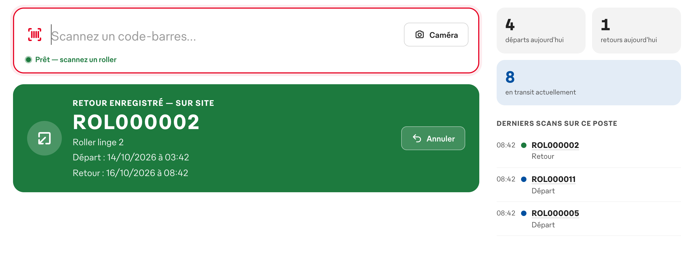
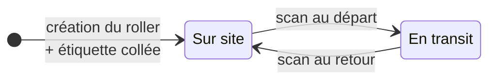
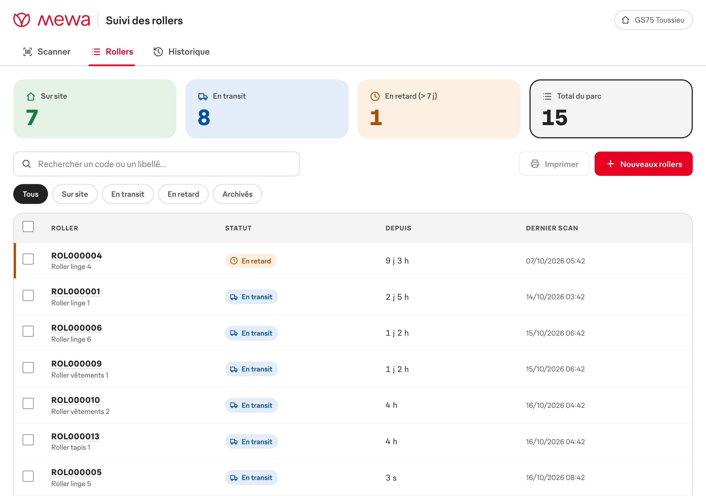
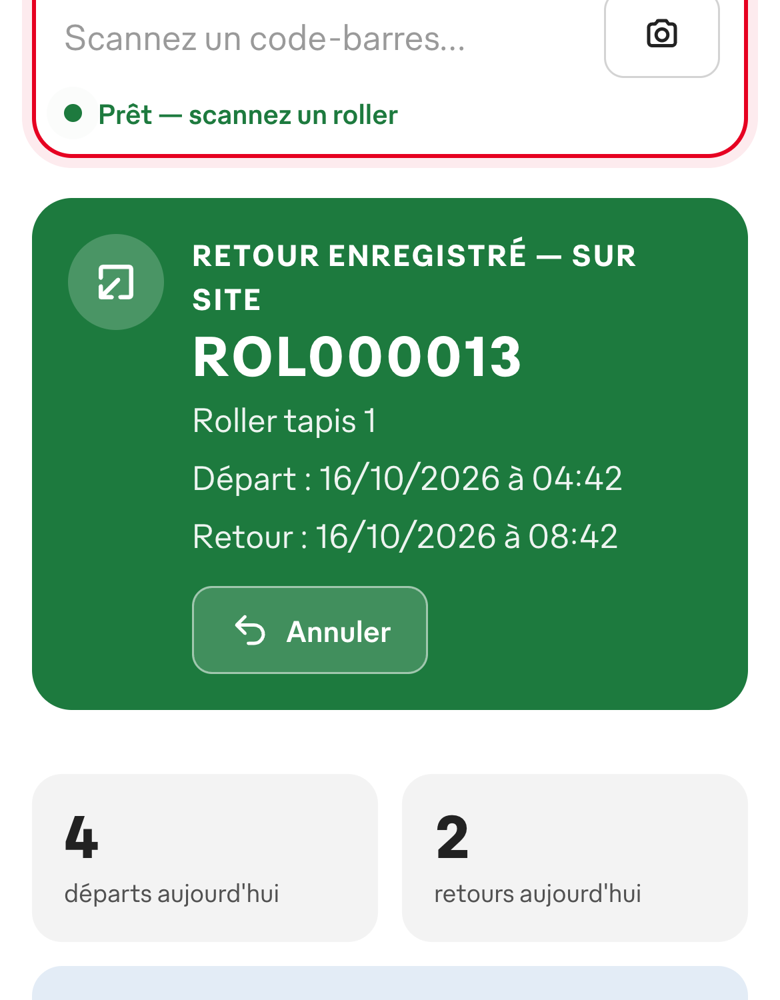
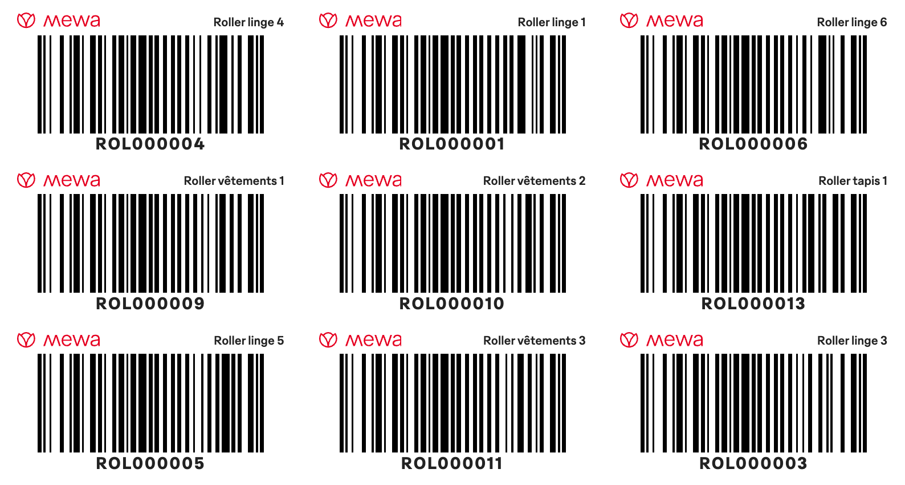

<p align="center">
  
</p>

<h1 align="center">Suivi des rollers</h1>

<p align="center">
  Scannez un roller quand il part, rescannez-le quand il revient :<br>
  vous savez à tout moment lesquels sont <b>en transit</b> et lesquels sont <b>sur site</b>.
</p>

<p align="center">
  
  
  
  
  
</p>

<p align="center">
  
</p>

---

## En bref

| | |
|---|---|
| **Un scan, aucun clic** | La douchette lit l'étiquette et c'est enregistré. Pas de bouton, pas de touche Entrée. |
| **Départ ou retour, automatiquement** | Un roller sur site part en transit, un roller en transit revient sur site. |
| **Lisible de loin** | Écran bleu pour un départ, vert pour un retour, rouge pour un code inconnu, avec un bip différent pour chacun. |
| **Dates précises** | Au retour, l'écran affiche la date et l'heure du départ et du retour. |
| **Erreurs rattrapées** | Bouton « Annuler ». Une double lecture accidentelle de la douchette est ignorée. |
| **Étiquettes prêtes à imprimer** | Codes-barres générés à la création, sur imprimante d'étiquettes ou planche A4. |
| **Vue d'ensemble** | Rollers sur site, en transit, en retard, historique complet et export Excel. |
| **Rien à installer sur le poste** | Un navigateur suffit, sur PC avec douchette, tablette ou smartphone (mode caméra). |

## Fonctionnement



Chaque scan est enregistré au nom du poste (**GS75 Toussieu**), avec sa date et son heure.

## Installation

Pré-requis : un serveur avec **Docker** et **Docker Compose**.

```bash
git clone https://github.com/osayanis/mewa-suivi-rollers.git
cd mewa-suivi-rollers
cp .env.example .env              # facultatif : réglages ci-dessous
docker compose up -d --build
```

Ouvrez ensuite **`http://<adresse-du-serveur>:8080`**. C'est prêt.

> [!TIP]
> **Mise à jour :** `git pull && docker compose up -d --build`. Les données sont conservées dans le volume Docker `rollers-data`.

> [!IMPORTANT]
> Avec une douchette, `http://` suffit. Le **mode caméra** (tablette, smartphone) exige **HTTPS** : il faut alors publier l'application derrière le reverse proxy de l'entreprise, par exemple `https://rollers.mewa.local` → `http://serveur:8080`.

### Réglages (`.env`)

| Variable | Rôle | Défaut |
|---|---|---|
| `STATION_NAME` | Nom du poste enregistré avec chaque scan | `GS75 Toussieu` |
| `ACCESS_CODE` | Code demandé une seule fois par appareil (vide = aucun code) | *vide* |
| `OVERDUE_DAYS` | Nombre de jours en transit avant le statut « en retard » | `7` |
| `DUPLICATE_WINDOW_SECONDS` | Double lecture accidentelle ignorée dans ce délai (`0` = désactivé) | `2` |
| `CODE_PREFIX` · `CODE_DIGITS` | Format des codes-barres | `ROL` · `6` |

Après une modification : `docker compose up -d`.

## Aperçu

<p align="center">
  
  <br><sub><b>Onglet Rollers</b> : compteurs, filtres, liste triée (les rollers en retard en premier), création et impression.</sub>
</p>

<table>
  <tr>
    <td align="center" width="38%">
      <br>
      <sub><b>Sur smartphone ou tablette</b></sub>
    </td>
    <td align="center">
      <br>
      <sub><b>Étiquettes</b> : logo Mewa, libellé et code-barres Code 128</sub>
    </td>
  </tr>
</table>

## Étiquettes et matériel

- **Codes** : `ROL000042` en **Code 128**, créés automatiquement avec chaque roller.
- **Impression** :
  - **étiquette 100 × 50 mm** sur imprimante d'étiquettes (Zebra, Brother…) ;
  - **planche A4 de 3 × 8** étiquettes autocollantes 70 × 37 mm.
  - Imprimez à **100 %**, sans « ajuster à la page ». En milieu industriel, préférez des étiquettes polyester ou plastifiées.
- **Douchettes** : tout modèle USB ou Bluetooth en mode clavier, avec le Code 128 activé. Le suffixe Entrée est facultatif.
- **Robustesse** :
  - une douchette réglée en QWERTY sur un PC en AZERTY fonctionne quand même (`ROLàààà&é` est corrigé en `ROL000012`) ;
  - le scan arrive dans la bonne zone même si le curseur est ailleurs.

## Développement

Il faut Node.js 22 ou plus récent.

```bash
# Terminal 1 : interface, reconstruite à chaque modification
cd frontend && npm install && npm run dev

# Terminal 2 : serveur (API + interface) sur http://localhost:8080
cd backend && npm install && PUBLIC_DIR=../frontend/dist npm run dev
```

| Commande | Vérifie |
|---|---|
| `cd backend && npm test` | API : scans, double lecture, annulation, export CSV, code d'accès, en-têtes de sécurité |
| `cd frontend && npm run test:barcode` | Les codes-barres générés sont relus correctement par un décodeur (ZXing) |
| `cd frontend && npm run typecheck` | Types TypeScript |

<details>
<summary><b>Organisation du code</b></summary>

```
.
├── Dockerfile               # image unique : construit l'interface puis lance le serveur
├── docker-compose.yml
├── .env.example
├── backend/                 # Node.js 24 · Express · SQLite intégré (node:sqlite)
│   ├── src/
│   │   ├── server.js        # démarrage
│   │   ├── app.js           # routes API + service de l'interface (CSP)
│   │   ├── db.js            # base de données, logique départ / retour / annulation
│   │   ├── auth.js          # code d'accès (facultatif) et nom du poste
│   │   ├── codes.js         # format des codes, correction AZERTY
│   │   └── config.js        # variables d'environnement
│   └── test/
└── frontend/                # TypeScript sans framework · esbuild
    ├── index.html
    └── src/app/
        ├── views/           # Scanner, Rollers, Historique
        ├── barcode/         # générateur Code 128 (SVG)
        ├── brand/           # logo et police Gebauer de Mewa
        ├── labels.ts        # impression des étiquettes
        └── camera.ts        # scan par caméra
```
</details>

<details>
<summary><b>API</b></summary>

Si `ACCESS_CODE` est défini, toutes les routes sauf `/api/health` exigent l'en-tête `X-Access-Code`.

| Méthode | Route | Rôle |
|---|---|---|
| `POST` | `/api/scans` `{ code }` | Départ si le roller est sur site, retour s'il est en transit |
| `POST` | `/api/movements/:id/cancel` | Annuler le dernier mouvement d'un roller |
| `GET` | `/api/stats` | Compteurs (sur site, en transit, en retard, du jour) |
| `GET` · `POST` | `/api/rollers` | Liste (filtres `status`, `q`) · création (`count`, `label`) |
| `GET` · `PATCH` | `/api/rollers/:code` | Fiche + historique · modification, archivage |
| `GET` | `/api/movements` | Historique |
| `GET` | `/api/export/movements.csv` | Export Excel |
| `GET` | `/api/info` | Nom du poste et format des codes |
| `GET` | `/api/health` | Supervision |
</details>

<details>
<summary><b>Sauvegarde des données</b></summary>

Toutes les données tiennent dans un seul fichier SQLite, stocké dans le volume `rollers-data`. Pour faire une copie à chaud :

```bash
docker compose exec rollers node -e "new (require('node:sqlite').DatabaseSync)('/data/rollers.db').exec(\"VACUUM INTO '/data/backup.db'\")"
docker compose cp rollers:/data/backup.db ./sauvegarde-$(date +%F).db
docker compose exec rollers rm /data/backup.db
```
</details>

## À savoir

- **Un seul poste pour l'instant** : les scans sont enregistrés au nom du poste, pas d'un agent. Si d'autres PC sont ajoutés, chacun pourra avoir son propre `STATION_NAME`.
- **Code d'accès** : il empêche que n'importe qui sur le réseau utilise l'outil. Ce n'est pas une authentification individuelle.
- **Police Gebauer** : c'est la police d'entreprise de Mewa (fonderie TypeMates), et elle est incluse dans ce dépôt **privé**. Ne pas rendre le dépôt public sans l'accord de la communication.

<p align="center"><sub>Outil interne Mewa · Service informatique</sub></p>
