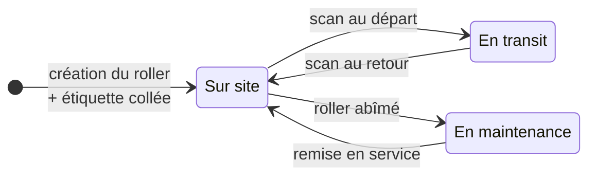
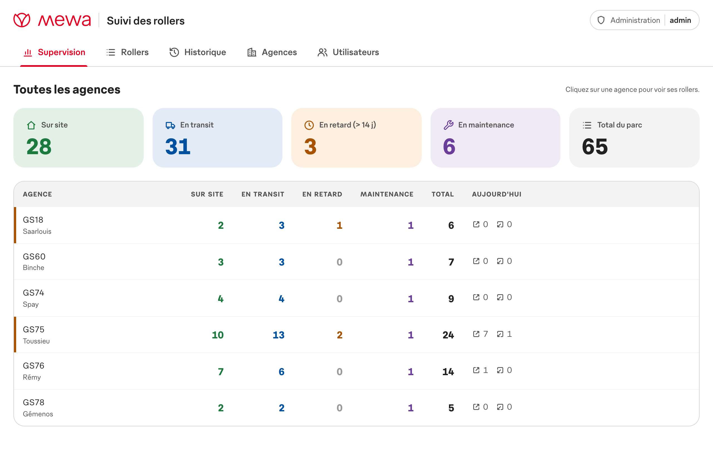
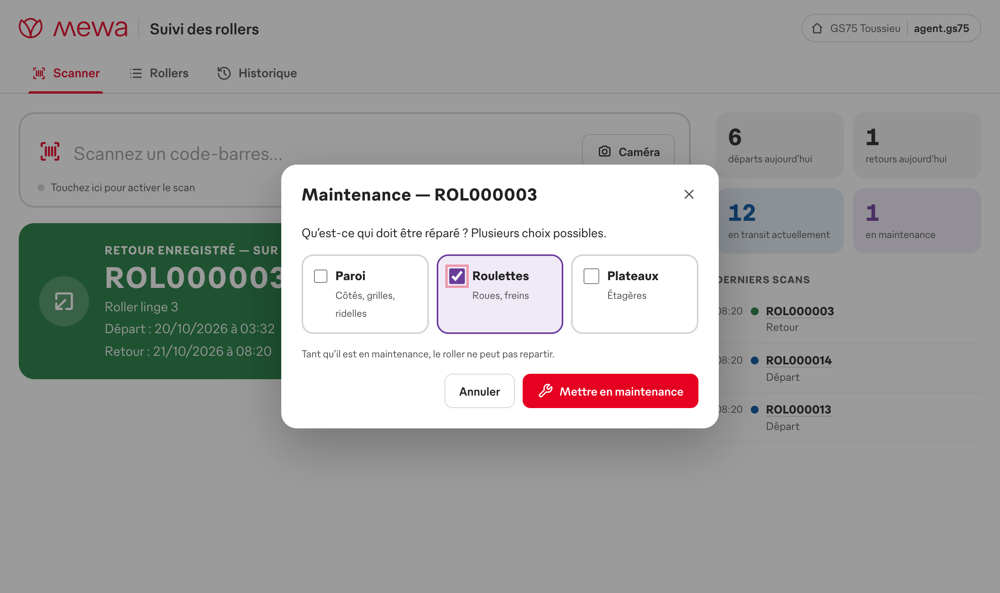
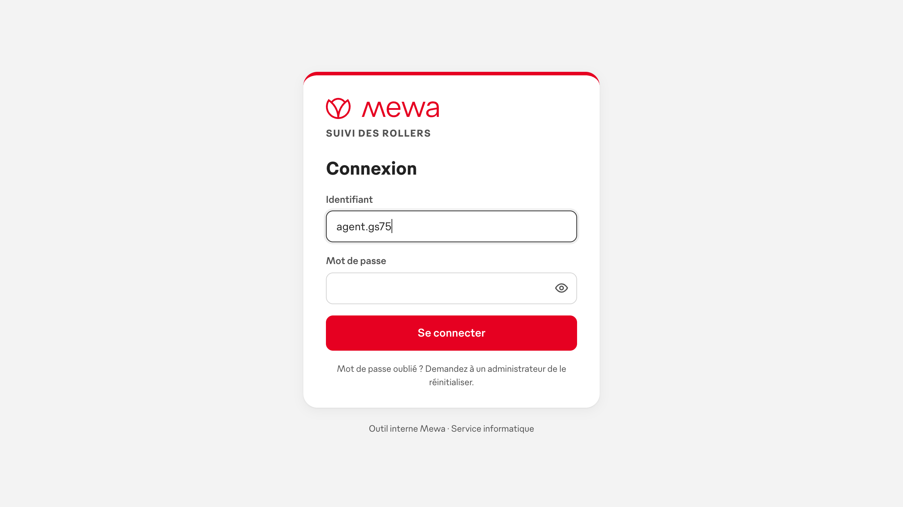
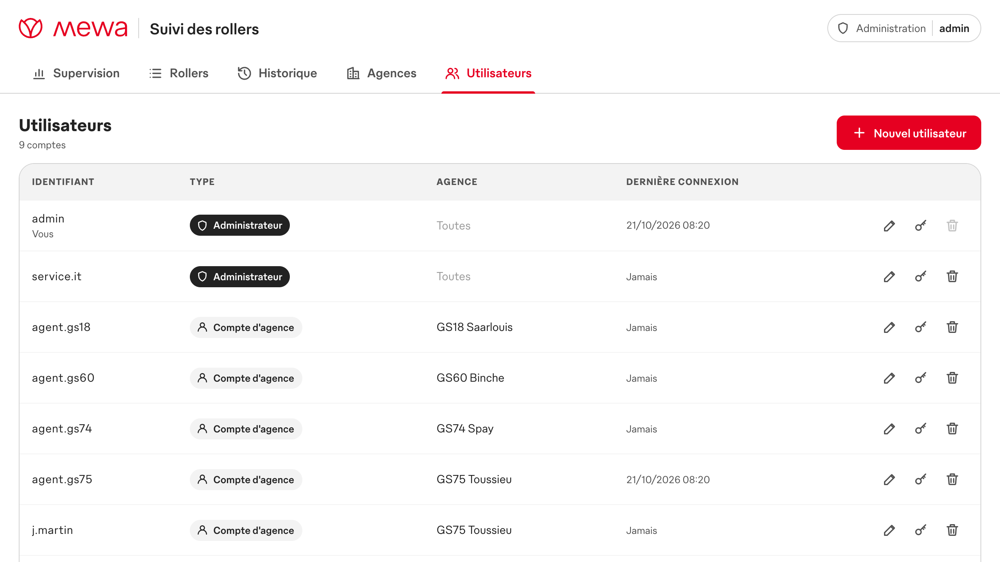

<p align="center">
  
</p>

<h1 align="center">Suivi des rollers</h1>

<p align="center">
  Scannez un roller quand il part, rescannez-le quand il revient :<br>
  chaque agence sait à tout moment lesquels sont <b>en transit</b>, <b>sur site</b> ou <b>en maintenance</b>.
</p>

<p align="center">
  
  
  
  
  
  
</p>

<p align="center">
  
</p>

---

## En bref

| | |
|---|---|
| **Un compte par personne** | Connexion par identifiant et mot de passe. Chaque compte d'agence ne voit que les rollers de son agence. |
| **Supervision globale** | Le compte administrateur voit toutes les agences, crée les agences et gère les comptes. |
| **Un scan, aucun clic** | La douchette lit l'étiquette et c'est enregistré. Pas de bouton, pas de touche Entrée. |
| **Départ ou retour, automatiquement** | Un roller sur site part en transit, un roller en transit revient sur site. |
| **Maintenance** | Un roller abîmé est mis en maintenance (paroi, roulettes, plateaux) : il ne peut plus repartir avant sa remise en service. |
| **Lisible de loin** | Écran bleu pour un départ, vert pour un retour, violet pour une maintenance, rouge pour une erreur, avec un bip différent. |
| **Retards signalés** | Un roller en transit depuis plus de **14 jours** passe « en retard ». |
| **Rescan vérifié** | Un roller rescanné moins de **24 heures** après son dernier scan affiche « déjà scanné le … à …h…, êtes-vous certain ? ». **Oui** (ou Entrée) l'enregistre, **Non** l'abandonne. |
| **Erreurs rattrapées** | Bouton « Annuler ». Une double lecture accidentelle de la douchette est ignorée. |
| **Étiquettes prêtes à imprimer** | Codes-barres générés à la création, sur imprimante d'étiquettes ou planche A4. |
| **Rien à installer sur le poste** | Un navigateur suffit, sur PC avec douchette, tablette ou smartphone (mode caméra). |

## Fonctionnement



Chaque mouvement est enregistré avec sa date, son heure, l'agence et l'utilisateur connecté.

### Comptes et agences

| Type de compte | Agence | Onglets |
|---|---|---|
| **Compte d'agence** | Obligatoire (une seule) | Scanner · Rollers · Historique de **son agence** |
| **Administrateur** | Aucune | Supervision · Rollers · Historique de **toutes les agences** · Agences · Utilisateurs |

Six agences sont créées au premier démarrage :

| Code | Ville |
|---|---|
| GS18 | Saarlouis |
| GS60 | Binche |
| GS74 | Spay |
| GS75 | Toussieu |
| GS76 | Rémy |
| GS78 | Gémenos |

L'onglet **Agences** permet d'en modifier ou d'en ajouter. Sur une base existante, la mise à jour ajoute les agences manquantes et complète les villes vides, sans remplacer une ville déjà saisie.

Les codes-barres sont numérotés pour toutes les agences à la fois : un code est unique dans tout Mewa. Un roller scanné dans la mauvaise agence est refusé avec le nom de son agence. L'administrateur peut transférer un roller d'une agence à une autre depuis sa fiche.

<p align="center">
  
  <br><sub><b>Supervision</b> : l'état du parc de chaque agence ; un clic ouvre les rollers de l'agence.</sub>
</p>

### Maintenance

Après le scan de retour, l'agent touche **Maintenance** et coche ce qui doit être réparé :

- **Paroi** : côtés, grilles, ridelles ;
- **Roulettes** : roues, freins ;
- **Plateaux** : étagères.

Plusieurs choix sont possibles. Un roller en maintenance scanné au départ est bloqué : l'écran violet propose **Remettre en service**. La maintenance se gère aussi depuis la fiche du roller (onglet Rollers).

<p align="center">
  
</p>

## Premier démarrage

1. Lancez l'application (voir ci-dessous).
2. Un compte **`admin`** est créé avec un **mot de passe provisoire**, affiché :
   - par `demarrer.bat` à la fin du lancement ;
   - dans le journal du serveur : `docker compose logs rollers` ;
   - dans le fichier `identifiants-admin-initial.txt`, à côté de la base de données.
3. Connectez-vous avec `admin` et ce mot de passe : l'application demande d'en choisir un nouveau. Le fichier est alors supprimé.
4. Onglet **Utilisateurs** : créez un compte par agent (ou par poste) et rattachez-le à son agence.

> [!TIP]
> Pour choisir vous-même le mot de passe initial, renseignez `ADMIN_PASSWORD` dans `.env` **avant** le premier démarrage.

> [!NOTE]
> Mot de passe oublié : un administrateur en définit un nouveau dans **Utilisateurs** (bouton clé). Les appareils connectés avec l'ancien sont déconnectés. Chacun peut changer son propre mot de passe depuis **Mon compte**, en haut à droite.

## Lancement en un double-clic (Windows)

1. Installez **Docker Desktop** (recommandé) ou **Node.js** (version LTS).
2. Récupérez le projet (`gh repo clone osayanis/mewa-suivi-rollers`, ou bouton **Code → Download ZIP**).
3. Double-cliquez sur **`demarrer.bat`**.

Le script choisit le bon mode :
- **Docker** s'il est installé : il démarre Docker Desktop si besoin, puis lance le conteneur ;
- sinon **Node.js** : il installe ce qu'il faut, puis lance le serveur dans une fenêtre réduite.

Il attend ensuite que l'application réponde et l'ouvre dans le navigateur. Au premier démarrage, il affiche les identifiants administrateur provisoires. S'il est relancé alors que l'application tourne déjà, il ouvre seulement le navigateur.

Pour arrêter l'application : **`arreter.bat`**. Les données sont conservées.

> [!NOTE]
> Si Windows affiche « Windows a protégé votre ordinateur », cliquez sur **Informations complémentaires → Exécuter quand même**. C'est normal pour un script téléchargé.

## Installation sur un serveur

Pré-requis : un serveur avec **Docker** et **Docker Compose**.

```bash
git clone https://github.com/osayanis/mewa-suivi-rollers.git
cd mewa-suivi-rollers
cp .env.example .env              # facultatif : réglages ci-dessous
docker compose up -d --build
docker compose logs rollers       # identifiants administrateur provisoires
```

Ouvrez ensuite **`http://<adresse-du-serveur>:8080`**.

> [!TIP]
> **Mise à jour :** `git pull && docker compose up -d --build`. Les données sont conservées dans le volume Docker `rollers-data`. Une base créée avec une version précédente (un seul poste) est migrée automatiquement : ses rollers et son historique sont rattachés à **GS75 Toussieu**.

> [!IMPORTANT]
> Les agences se connectent au serveur par le réseau : publiez l'application derrière le reverse proxy de l'entreprise, en **HTTPS** (par exemple `https://rollers.mewa.local` → `http://serveur:8080`). Les mots de passe ne circulent alors jamais en clair, et le **mode caméra** (tablette, smartphone), qui exige HTTPS, fonctionne.

### Réglages (`.env`)

| Variable | Rôle | Défaut |
|---|---|---|
| `ADMIN_USERNAME` | Identifiant du compte administrateur créé au premier démarrage | `admin` |
| `ADMIN_PASSWORD` | Son mot de passe (vide = mot de passe provisoire généré) | *vide* |
| `SESSION_DAYS` | Une session reste ouverte tant qu'elle sert au moins une fois dans ce délai | `30` |
| `OVERDUE_DAYS` | Nombre de jours en transit avant le statut « en retard » | `14` |
| `RESCAN_CONFIRM_HOURS` | Rescan demandant une confirmation s'il a lieu moins de N heures après le dernier scan (`0` = jamais) | `24` |
| `DUPLICATE_WINDOW_SECONDS` | Double lecture accidentelle ignorée dans ce délai (`0` = désactivé) | `2` |
| `CODE_PREFIX` · `CODE_DIGITS` | Format des codes-barres | `ROL` · `6` |

Après une modification : `docker compose up -d`.

## Aperçu

<p align="center">
  
  <br><sub><b>Onglet Rollers</b> : compteurs, filtres, liste triée (les rollers en retard en premier), création et impression.</sub>
</p>

<table>
  <tr>
    <td align="center" width="38%">
      <br>
      <sub><b>Sur smartphone ou tablette</b></sub>
    </td>
    <td align="center">
      <br>
      <sub><b>Connexion</b></sub>
      <br><br>
      <br>
      <sub><b>Étiquettes</b> : logo Mewa, libellé et code-barres Code 128</sub>
    </td>
  </tr>
</table>

<p align="center">
  
  <br><sub><b>Utilisateurs</b> : création, agence, mot de passe et suppression des comptes.</sub>
</p>

## Étiquettes et matériel

- **Codes** : `ROL000042` en **Code 128**, créés automatiquement avec chaque roller.
- **Impression** :
  - **étiquette 100 × 50 mm** sur imprimante d'étiquettes (Zebra, Brother…) ;
  - **planche A4 de 3 × 8** étiquettes autocollantes 70 × 37 mm.
  - Imprimez à **100 %**, sans « ajuster à la page ». En milieu industriel, préférez des étiquettes polyester ou plastifiées.
- **Douchettes** : tout modèle USB ou Bluetooth en mode clavier, avec le Code 128 activé. Le suffixe Entrée est facultatif.
- **Robustesse** :
  - une douchette réglée en QWERTY sur un PC en AZERTY fonctionne quand même (`ROLàààà&é` est corrigé en `ROL000012`) ;
  - le scan arrive dans la bonne zone même si le curseur est ailleurs.

## Sécurité

- Mots de passe stockés sous forme d'empreinte **scrypt** (jamais en clair), 8 caractères minimum.
- Session dans un cookie `HttpOnly`, `SameSite=Strict` (et `Secure` derrière HTTPS) ; en-tête anti-falsification exigé sur toute modification.
- Après 10 échecs de connexion en 15 minutes sur un même identifiant depuis un même poste, les essais sont bloqués temporairement.
- Un compte d'agence n'accède jamais aux données d'une autre agence ; l'administration est réservée aux administrateurs. Il reste toujours au moins un administrateur, et personne ne peut supprimer son propre compte.

## Développement

Il faut Node.js 22.13 ou plus récent.

```bash
# Terminal 1 : interface, reconstruite à chaque modification
cd frontend && npm install && npm run dev

# Terminal 2 : serveur (API + interface) sur http://localhost:8080
cd backend && npm install && PUBLIC_DIR=../frontend/dist npm run dev
```

| Commande | Vérifie |
|---|---|
| `cd backend && npm test` | API : connexion, droits par agence, administration, scans, maintenance, retards, annulation, migration, export CSV |
| `cd frontend && npm run test:barcode` | Les codes-barres générés sont relus correctement par un décodeur (ZXing) |
| `cd frontend && npm run typecheck` | Types TypeScript |

> [!WARNING]
> Ne gardez pas le projet dans un dossier synchronisé par **iCloud** (Bureau ou Documents d'un Mac) : iCloud retire des fichiers du disque, dont `node_modules`, ce qui bloque les commandes. Préférez par exemple `~/Developer/`.

<details>
<summary><b>Organisation du code</b></summary>

```
.
├── demarrer.bat             # lancement en un double-clic (Windows)
├── arreter.bat              # arrêt de l'application
├── Dockerfile               # image unique : construit l'interface puis lance le serveur
├── docker-compose.yml
├── .env.example
├── backend/                 # Node.js 24 · Express · SQLite intégré (node:sqlite)
│   ├── src/
│   │   ├── server.js        # démarrage, compte administrateur initial
│   │   ├── app.js           # routes API + service de l'interface (CSP)
│   │   ├── schema.js        # tables et migrations
│   │   ├── db.js            # rollers : départ / retour / maintenance / annulation, par agence
│   │   ├── accounts.js      # agences, utilisateurs, mots de passe, sessions
│   │   ├── auth.js          # cookie de session, droits, limite des tentatives
│   │   ├── codes.js         # format des codes, correction AZERTY
│   │   └── config.js        # variables d'environnement
│   └── test/
└── frontend/                # TypeScript sans framework · esbuild
    ├── index.html
    └── src/app/
        ├── views/           # Connexion, Scanner, Rollers, Historique, Supervision, Agences, Utilisateurs
        ├── maintenance.ts   # mise en maintenance / remise en service
        ├── barcode/         # générateur Code 128 (SVG)
        ├── brand/           # logo et police Gebauer de Mewa
        ├── labels.ts        # impression des étiquettes
        └── camera.ts        # scan par caméra
```
</details>

<details>
<summary><b>API</b></summary>

Toutes les routes sauf `/api/health` et `/api/auth/*` exigent une session. Les requêtes qui modifient des données exigent l'en-tête `X-Requested-With`. Pour un administrateur, `?agency=<id>` limite les listes à une agence.

| Méthode | Route | Rôle |
|---|---|---|
| `POST` | `/api/auth/login` `{ username, password }` | Connexion (pose le cookie de session) |
| `POST` | `/api/auth/logout` | Déconnexion |
| `GET` | `/api/auth/me` | Utilisateur connecté (`null` sans session) |
| `POST` | `/api/auth/password` `{ currentPassword, newPassword }` | Changer son mot de passe |
| `POST` | `/api/scans` `{ code, confirm? }` | Départ si le roller est sur site, retour s'il est en transit ; `result: "confirm"` si le dernier scan date de moins de 24 h (renvoyer avec `confirm: true`) |
| `POST` | `/api/movements/:id/cancel` | Annuler le dernier mouvement d'un roller |
| `GET` | `/api/stats` | Compteurs (sur site, en transit, en retard, en maintenance, du jour) |
| `GET` · `POST` | `/api/rollers` | Liste (filtres `status`, `q`) · création (`count`, `label`, `agencyId` pour un admin) |
| `GET` · `PATCH` | `/api/rollers/:code` | Fiche + historique · modification, archivage, transfert (admin) |
| `POST` · `DELETE` | `/api/rollers/:code/maintenance` | Mise en maintenance `{ reasons }` · remise en service |
| `GET` | `/api/movements` | Historique |
| `GET` | `/api/export/movements.csv` | Export Excel |
| `GET` | `/api/info` | Format des codes, délai de retard, raisons de maintenance |
| `GET` | `/api/admin/overview` | Supervision de toutes les agences |
| `GET` · `POST` · `PATCH` · `DELETE` | `/api/admin/agencies[/:id]` | Agences |
| `GET` · `POST` · `PATCH` · `DELETE` | `/api/admin/users[/:id]` | Utilisateurs |
| `GET` | `/api/health` | Supervision technique |
</details>

<details>
<summary><b>Sauvegarde des données</b></summary>

Toutes les données (rollers, historique, agences, comptes) tiennent dans un seul fichier SQLite, stocké dans le volume `rollers-data`. Pour faire une copie à chaud :

```bash
docker compose exec rollers node -e "new (require('node:sqlite').DatabaseSync)('/data/rollers.db').exec(\"VACUUM INTO '/data/backup.db'\")"
docker compose cp rollers:/data/backup.db ./sauvegarde-$(date +%F).db
docker compose exec rollers rm /data/backup.db
```

La sauvegarde contient les empreintes des mots de passe : conservez-la en lieu sûr.
</details>

## À savoir

- **Police Gebauer** : c'est la police d'entreprise de Mewa (fonderie TypeMates), et elle est incluse dans ce dépôt **privé**. Ne pas rendre le dépôt public sans l'accord de la communication.

<p align="center"><sub>Outil interne Mewa · Service informatique</sub></p>
